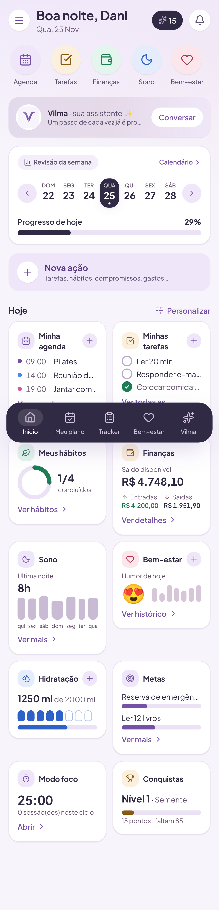
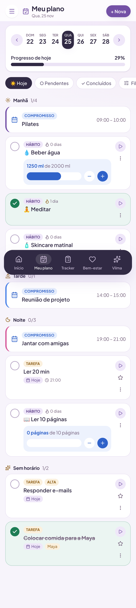
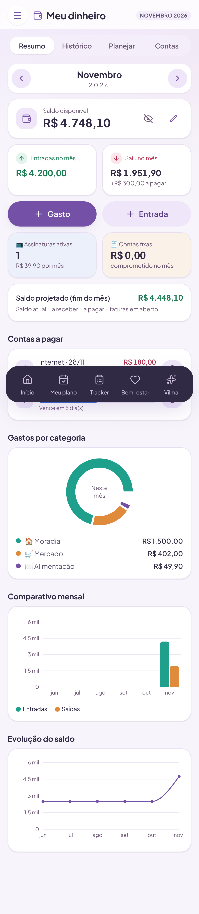
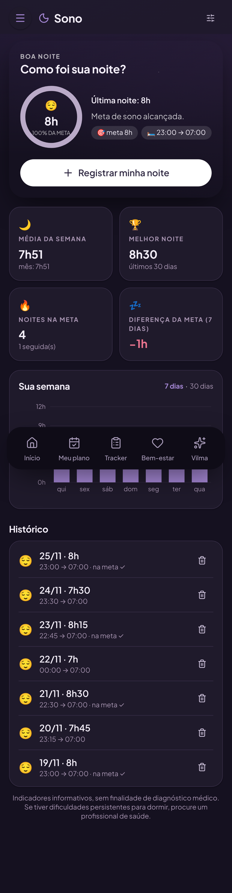

# Vilma — Minha Vida 💜

Central inteligente de organização pessoal em português: **agenda, tarefas, hábitos, finanças, sono, humor e diário, ciclo menstrual, hidratação, treinos, trabalho, estudos, casa, anotações, metas, modo foco, gamificação e automações** — integrados num único app instalável (PWA), com a **assistente Vilma** (IA da Anthropic) que entende pedidos em linguagem natural e registra dados reais no app.

> Identidade visual em roxo/lilás/lavanda (paleta oficial do projeto), mobile-first, modo claro e escuro.

<p align="center">   </p>

## Usar agora (modo local, sem servidor)

Existe uma versão que funciona **sem Supabase e sem servidor**: os dados ficam guardados no próprio aparelho/navegador.

- **Endereço (após ativar o GitHub Pages uma vez):** `https://almatti.github.io/ROTINA-PESSOAL/`
- **Ativação (uma única vez):** no GitHub, *Settings › Pages › Build and deployment › Source: Deploy from a branch › Branch: `gh-pages` / `(root)` › Save*. A publicação é automática a cada atualização (workflow `.github/workflows/pages-local.yml`).
- **Gerar localmente:** `npm run build:local` (saída em `out/`, publique em qualquer hospedagem estática).

Funciona no modo local: todas as telas e módulos, contas locais, gráficos, automações (rodam ao abrir o app), lembretes com o app aberto, exportação/exclusão de dados e uma **Vilma local** que entende comandos simples (“gastei 45,90 no mercado”, “academia amanhã às 7h”, “quais tarefas estão pendentes?”, “quanto gastei este mês?”, “resumo da semana”).
Fica para a versão online: sincronização entre aparelhos, recuperação de senha por e-mail, login com Google, IA completa (Anthropic), Google Agenda e push com o app fechado. Faça backups em *Configurações › Privacidade › Exportar*.

## Sumário

- [Funcionalidades](#funcionalidades)
- [Stack](#stack)
- [Começando (desenvolvimento)](#começando-desenvolvimento)
- [Variáveis de ambiente](#variáveis-de-ambiente)
- [Scripts](#scripts)
- [Estrutura do projeto](#estrutura-do-projeto)
- [Documentação](#documentação)
- [Integrações que dependem de configuração externa](#integrações-que-dependem-de-configuração-externa)

## Funcionalidades

| Área | O que tem |
|---|---|
| **Início** | Saudação por horário, data, faixa semanal interativa, progresso do dia, “Nova ação” com linguagem natural, cartões clicáveis (agenda, tarefas, hábitos, finanças, sono, humor, água, metas, foco, conquistas) com ordem e visibilidade personalizáveis, notificações e pontos |
| **Meu plano** | Tarefas, hábitos e compromissos do dia agrupados por Manhã/Tarde/Noite/Sem horário, filtros, contador de água inline, checklists expansíveis |
| **Agenda** | Visões dia/semana/mês/ano, recorrência, categorias e cores, dia inteiro, lembretes, busca, arrastar e soltar, detecção de conflitos, Google Agenda bidirecional |
| **Google Tasks** | Tarefas, hábitos do dia, provas, etapas de projeto, rotinas e manutenções na lista “Vilma” do Google Tasks, nos dois sentidos (concluir no Google conclui no app); itens com horário ganham alarme no Google Agenda |
| **Tarefas** | Lista e Kanban, prioridades, subtarefas/checklist, recorrência, lembretes, tempo estimado, status (pendente, em andamento, concluída, atrasada*, cancelada), filtros, busca, ordenação e indicadores de produtividade |
| **Hábitos / Tracker** | Frequências personalizadas, metas quantitativas e unidades, checklist interno, sequências, taxa de conclusão, grade de 30 dias, calendário, gráfico de consistência, hábitos para “largar” (dias livres e economia estimada) |
| **Finanças** | Contas, saldo real, receitas/despesas, a pagar/receber, contas fixas e assinaturas (geração automática), cartões, faturas, parcelamento, transferências, orçamentos e limites, metas/reserva vinculadas a contas, categorias personalizadas, gráficos (rosca, barras, linha), saldo projetado, exportação CSV/PDF |
| **Bem-estar** | Sono (atravessa a meia-noite, médias, metas, diferença acumulada), humor e diário (emojis, intensidade, energia, sentimentos, gratidão, calendário de emoções, gráficos), ciclo menstrual opcional com consentimento (previsões estimadas), hidratação (copos interativos), treinos (fichas, divisão semanal, séries/cargas, cronômetro e descanso, evolução) |
| **Vida** | Trabalho e projetos (etapas, Kanban de tarefas, links, horas, reuniões; separação pessoal/profissional/acadêmico), estudos (cursos, cronograma, provas, revisões espaçadas, notas, horas), casa (cômodos, rotina de limpeza, compras, produtos, refeições, manutenção), anotações (pastas, tags, favoritos, listas, Markdown, anexos, links e relações), metas (anual/mensal/semanal, etapas, vision board, revisão, conquistas) |
| **Vilma (IA)** | Chat com histórico, sugestões, voz (Web Speech), indicadores de processamento, 25 ferramentas validadas que leem/gravam dados do app, confirmação obrigatória para exclusões e alterações em massa |
| **Automações** | 12 automações configuráveis (recorrências, contas fixas, atrasadas, reagendamento sugerido, compromissos próximos, vencimentos, resumo da manhã, revisão da noite, planejamento semanal, relatório mensal, metas, progresso) via Vercel Cron + execução manual |
| **Gamificação** | Pontos, níveis, medalhas, avatar personalizável com molduras por nível, progresso semanal/mensal — sem punições |
| **Privacidade (LGPD)** | Consentimentos registrados, política de privacidade, exportação de dados (JSON), exclusão de conta, revogação de IA/integrações, dados sensíveis protegidos, RLS por usuária, limitação de requisições |
| **PWA** | Manifesto, ícones próprios, service worker, instalação, uso offline das telas já visitadas, fila de alterações offline com sincronização automática, notificações locais e Web Push (com o app fechado) |

\* “Atrasada” é derivada automaticamente do prazo.

## Stack

Next.js 15 (App Router) · React 19 · TypeScript · Tailwind CSS 4 · Supabase (PostgreSQL, Auth, Storage, Realtime) · Anthropic API (`claude-opus-5-5`) · Google Calendar API · Recharts · Framer Motion · Lucide · Zod · Vitest · Playwright · Vercel.

## Começando (desenvolvimento)

Pré-requisitos: Node.js 20+ e um projeto Supabase (gratuito).

```bash
npm install
cp .env.example .env.local      # preencha as variáveis
# aplique as migrations em supabase/migrations (ver docs/INSTALACAO-E-PUBLICACAO.md)
npm run dev                      # http://localhost:3000
```

Sem Supabase configurado, o app mostra a página **/configuracao** listando o que falta.

## Variáveis de ambiente

| Variável | Obrigatória | Uso |
|---|---|---|
| `NEXT_PUBLIC_SUPABASE_URL` / `NEXT_PUBLIC_SUPABASE_ANON_KEY` | sim | conexão do app (chave pública; acesso limitado por RLS) |
| `NEXT_PUBLIC_SITE_URL` | sim em produção | redirecionamentos de login e OAuth |
| `SUPABASE_SERVICE_ROLE_KEY` | recomendada | exclusão de conta, Google Agenda, cron de automações (somente servidor) |
| `ANTHROPIC_API_KEY` (`ANTHROPIC_MODEL` opcional) | não | Vilma com Claude (pago; tem prioridade) |
| `GEMINI_API_KEY` (`GEMINI_MODEL` opcional) | não | Vilma com Gemini (plano gratuito do Google). Sem nenhuma chave, a Vilma funciona no modo básico, sem IA |
| `NEXT_PUBLIC_GOOGLE_AUTH` | para login com Google | `1` mostra “Continuar com Google” (ative antes o provedor Google no Supabase) |
| `GOOGLE_CLIENT_ID` / `GOOGLE_CLIENT_SECRET` | para Google Agenda | OAuth (somente servidor) |
| `INTEGRATIONS_ENCRYPTION_KEY` | para Google Agenda | criptografia AES-256-GCM dos tokens (`openssl rand -base64 32`) |
| `CRON_SECRET` | para automações agendadas | autenticação do Vercel Cron |
| `NEXT_PUBLIC_VAPID_PUBLIC_KEY` / `VAPID_PRIVATE_KEY` / `VAPID_SUBJECT` | para push | notificações com o app fechado (`npx web-push generate-vapid-keys`) |

Nenhuma chave privada é exposta ao navegador.

## Scripts

| Comando | Descrição |
|---|---|
| `npm run dev` / `build` / `start` | desenvolvimento, build e servidor de produção |
| `npm run typecheck` / `lint` | TypeScript e ESLint |
| `npm test` | testes unitários (Vitest) |
| `npm run test:db` | migrations + testes de RLS/integridade num PostgreSQL local |
| `npm run test:e2e` | E2E (Playwright) com PostgreSQL real e shim do Supabase |
| `npm run icons` | regenera os ícones do PWA |
| `npm run build:local` | gera a versão modo local (site estático em `out/`) |
| `npx playwright test -c playwright.local.config.ts` | E2E da versão local (após `NEXT_PUBLIC_BASE_PATH=/ROTINA-PESSOAL npm run build:local`) |

## Estrutura do projeto

```
src/
  app/(public)/        boas-vindas, login, cadastro, recuperação, privacidade, termos
  app/(app)/           telas autenticadas (25 módulos)
  app/api/             vilma, google, automations, cron, account (export/delete)
  components/          design system (ui), layout, formulários, gráficos, módulos
  lib/domain/          regras puras e testadas: datas/fuso, dinheiro, finanças, recorrência, sono, hábitos, ciclo, NLP…
  lib/data/            cache, fila offline, realtime, ações
  lib/vilma/           ferramentas da IA, prompt e cliente Anthropic
  lib/automation/      motor de automações e geração de contas fixas
  lib/google/          OAuth e sincronização do Google Agenda
supabase/migrations/   schema, RLS, seeds de catálogo, storage
tests/unit · tests/db · tests/e2e
docs/                  documentação técnica, instalação, testes e guia de uso
legacy/                protótipo original (HTML/JS) mantido como referência
```

## Documentação

- [Instalação, configuração das APIs e publicação](docs/INSTALACAO-E-PUBLICACAO.md)
- [Arquitetura e documentação técnica](docs/ARQUITETURA.md)
- [Relatório de testes](docs/RELATORIO-DE-TESTES.md)
- [Guia de uso (para quem não programa)](docs/GUIA-DE-USO.md)
- [Progresso, decisões e pendências](PROGRESS.md)

## Integrações que dependem de configuração externa

| Integração | Situação |
|---|---|
| Supabase (banco, auth, storage) | implementado; requer projeto e migrations |
| Login com Google | implementado no app; requer ativar o provedor Google no Supabase |
| Vilma | modo básico (sem IA) funciona sem configuração; Gemini gratuito com `GEMINI_API_KEY`; Claude com `ANTHROPIC_API_KEY`. Nenhum dos dois provedores foi testado contra a API real neste ambiente (testes com respostas simuladas do protocolo) |
| Google Agenda + Google Tasks | implementado (OAuth + sincronização bidirecional + alarmes); requer credenciais Google Cloud com Calendar API e Tasks API; testado contra um Google simulado (13 testes), não contra o Google real |
| Automações agendadas | implementado; requer `CRON_SECRET` e deploy na Vercel |
| Notificações com o app fechado (Web Push) | implementado; requer chaves VAPID; para lembretes no minuto certo, agende o cron a cada 15 min (Vercel Pro ou agendador externo) |
